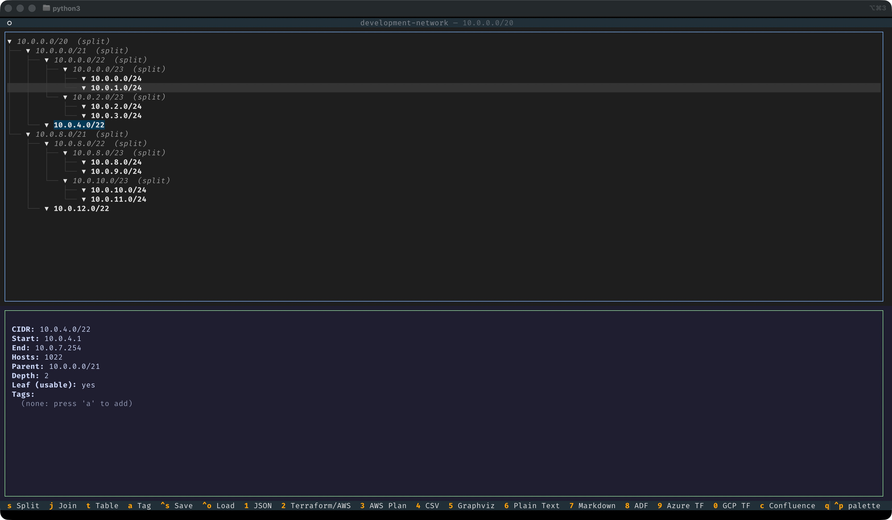

# CIDRSculpter

<p align="center">
  
  
  <a href="https://github.com/bytebeast/cidrsculpter/blob/main/LICENSE"></a>
  <a href="https://www.python.org/downloads/"></a>
</p>

> An interactive terminal UI for planning and sculpting IP address spaces —
> split, join, tag, visualise, and export to AWS, Azure, GCP, Terraform,
> Confluence, and more. Supports both IPv4 and IPv6.

---

## What It Does

CIDRSculpter lets you take a starting CIDR block (e.g. `10.0.0.0/20` or
`2001:db8::/32`) and interactively carve it into subnets. Each block can be
split in half, joined back together, and tagged with metadata (name,
environment, tier, etc.). When your plan looks right, export it in whatever
format your team needs.

No CIDR math in your head. No spreadsheets. No leaving the terminal.

---

## Screenshot (example)



---

## Installation

```bash
pip install rich textual
chmod +x cidrsculpter.py
./cidrsculpter.py
```

Requires Python 3.10+. No external CIDR library, all address arithmetic uses
Python's built-in `ipaddress` module.

---

## Layout

The app uses a **vertical split**: the CIDR tree occupies the top 60% of the
terminal and the detail panel sits below it, scrollable, making it easy to read
subnet information without losing context of the tree above.

---

## Quick Start

1. Run `./cidrsculpter.py`
2. Enter a plan name (e.g. `Production VPC`)
3. Enter a starting CIDR, IPv4 **or** IPv6 (e.g. `10.0.0.0/20` or
   `2001:db8::/32`)
4. Use the keyboard to split, join, and tag blocks
5. Press a number key to export

---

## Key Bindings

### Navigation & Editing

| Key | Action                                           |
| --- | ------------------------------------------------ |
| `s` | Split selected block into two equal halves       |
| `j` | Join selected block's two children back into one |
| `a` | Add / edit tags on the selected CIDR             |
| `t` | Open full table view of all CIDRs                |
| `q` | Quit                                             |

### Save & Load

| Key      | Action                                                   |
| -------- | -------------------------------------------------------- |
| `ctrl+s` | Save the current plan to `<Plan_Name>_plan.json`         |
| `ctrl+o` | Load a previously saved plan (also available at startup) |

Plans are saved as JSON and can be reloaded to continue working. The save file
preserves the full split tree, all tags, and the plan name.

### Exports

| Key | Format                         | Output file                 |
| --- | ------------------------------ | --------------------------- |
| `1` | JSON                           | `<name>_cidr.json`          |
| `2` | Terraform: AWS                 | `<name>_terraform.tf`       |
| `3` | AWS VPC plan JSON              | `<name>_aws_vpc_plan.json`  |
| `4` | CSV                            | `<name>_cidr.csv`           |
| `5` | Graphviz DOT diagram           | `<name>_cidr.dot`           |
| `6` | Plain text (space-delimited)   | `<name>_subnets.txt`        |
| `7` | Markdown table                 | `<name>_subnets.md`         |
| `8` | ADF: Atlassian Document Format | `<name>_subnets.adf.json`   |
| `9` | Terraform: Azure               | `<name>_azure.tf`           |
| `0` | Terraform: GCP                 | `<name>_gcp.tf`             |
| `c` | Confluence wiki markup         | `<name>_subnets.confluence` |

Output filenames are derived from your plan name:

- Spaces → underscores
- Dots, slashes, colons → hyphens
- Consecutive hyphens collapsed to one

Examples: `prod/vpc 1.0` → `prod-vpc_1-0`, `2001:db8::/32` → `2001-db8-32`

_Notes: Create cidr diagram using dot file._

```bash
dot -Tpng <name>_cidr.dot -o <name>_cidr.png
```

---

## IPv4 and IPv6

The model, tree, tables and documentation exports work the same for both
address families. Cloud exports differ, because the clouds do:

|                     | IPv4                     | IPv6                                                         |
| ------------------- | ------------------------ | ------------------------------------------------------------ |
| Starting CIDR       | `10.0.0.0/20`            | `2001:db8::/56` (a /56 for AWS)                              |
| Smallest block      | `/32`                    | `/128`                                                       |
| Host count display  | integer, plus per cloud  | `2^N` notation                                               |
| AWS Terraform       | `cidr_block`             | IPv6-only subnets placed with `cidrsubnet()` in Amazon's /56 |
| Azure Terraform     | `address_prefixes`       | refused: Azure subnets always need an IPv4 range too         |
| GCP Terraform       | `ip_cidr_range`          | refused: GCP assigns IPv6 ranges itself                      |

**Host count display:** IPv6 subnets contain astronomically large address counts
(a `/64` has 2⁶⁴ ≈ 18.4 quintillion addresses). CIDRSculpter displays these as
`2^N` notation throughout the UI and all exports.

**AWS IPv6:** AWS chooses the VPC's /56, so you cannot pick IPv6 addresses for a
VPC that uses an Amazon-provided block. The export therefore keeps your plan's
*layout*: every subnet becomes `cidrsubnet(aws_vpc.x.ipv6_cidr_block, newbits,
netnum)` at the same offset it has in your plan, as an IPv6-only subnet
(`ipv6_native = true`). Start IPv6 plans for AWS from a /56 and split subnets to
/60 or /64. The VPC still gets an IPv4 block (`var.vpc_ipv4_cidr`), because AWS
requires one.

---

## Cloud Checks

Each cloud rejects some sizes and ranges, and reserves addresses in every
subnet. CIDRSculpter checks these as you work and before every Terraform
export, so an export either applies or tells you why it would not.

| Rule                         | AWS                       | Azure                      | GCP                  |
| ---------------------------- | ------------------------- | -------------------------- | -------------------- |
| VPC / VNet size              | /16 to /28                | /29 or larger              | (no range)           |
| Subnet size                  | /16 to /28                | /29 or larger              | /29 or larger        |
| Reserved addresses / subnet  | 5                         | 5                          | 4                    |
| IPv6 subnet size             | /44 to /64, steps of 4    | not supported IPv6-only    | assigned by Google   |
| Special subnet names         |                           | `AzureBastionSubnet` and `AzureFirewallSubnet` /26+, `GatewaySubnet` /29+ |  |

Loopback, link-local, multicast and broadcast ranges are refused everywhere (and
168.63.129.16 on Azure). Public (non-RFC 1918) ranges and AWS overlaps with the
Docker bridge network `172.17.0.0/16` are warnings, written at the top of the
`.tf` file.

In the app:

- The detail panel shows **Usable in cloud** (e.g. `AWS 251  Azure 251  GCP 252`
  for a /24, against 254 generic hosts) and **Cloud fit** for the root and every
  leaf, with the reason when a cloud would reject it.
- The table view (`t`) has an `AWS/AZURE/GCP` usable column; the CSV export
  adds `USABLE_AWS`, `USABLE_AZURE` and `USABLE_GCP`, and the JSON export a
  `usable` object.
- A Terraform export (`2`, `9`, `0`) that a cloud would reject writes **no
  file**; the panel lists what to fix. The AWS JSON plan (`3`) is always
  written, with `valid_for_aws`, `errors` and `warnings` fields.

---

## Tagging

Press `a` on any CIDR to add tags as `key=value` pairs (comma-separated):

```
name=bastion001,private=false,tier=bastions
```

The `name` tag is special: used as the Terraform resource identifier, shown
distinctly in diagrams, and as the display name in tables and exports.

A few more tags steer the Terraform exports:

| Tag                        | Export | Effect                                                        |
| -------------------------- | ------ | ------------------------------------------------------------- |
| `az=us-east-1b`            | AWS    | Pins the subnet to that AZ (`availability_zone` also works)   |
| `region=europe-west1`      | GCP    | Puts the subnetwork in that region instead of `var.region`    |

Untagged AWS subnets are spread across `var.availability_zones` in address
order, so pass the AZs you want (for example `["us-east-1a", "us-east-1b",
"us-east-1c"]`).

---

## Sample Outputs

### Plain text (space-delimited)

```
# plan_name: Production VPC
# root_cidr: 10.0.0.0/20
CIDR          START       END          HOSTS  PARENT        DEPTH  IS_LEAF  NAME     OTHER_TAGS
10.0.0.0/20   10.0.0.1    10.0.15.254  4094   ROOT          0      no       -        -
10.0.0.0/22   10.0.0.1    10.0.3.254   1022   10.0.0.0/21   2      yes      private  tier=app
10.0.4.0/22   10.0.4.1    10.0.7.254   1022   10.0.0.0/21   2      yes      public   tier=web
10.0.8.0/21   10.0.8.1    10.0.15.254  2046   10.0.0.0/20   1      yes      data     tier=datastore
```

```bash
# print CIDR and name for all leaf subnets
awk 'NR>3 && $7=="yes" {print $1, $8}' Production_VPC_subnets.txt
```

### IPv6 plain text (host counts as 2^N)

```
# plan_name: IPv6 Plan
# root_cidr: 2001:db8::/32
CIDR                  HOSTS  IS_LEAF  NAME
2001:db8::/32         2^96   no       -
2001:db8::/33         2^95   yes      -
2001:db8:8000::/33    2^95   yes      -
```

### Terraform: AWS (IPv4)

```hcl
variable "availability_zones" {
  description = "AZs to spread subnets across in address order, ..."
  type        = list(string)
}

resource "aws_vpc" "production_vpc" {
  cidr_block = "10.0.0.0/20"
}

resource "aws_subnet" "private" {
  # resource name from 'name' tag
  vpc_id            = aws_vpc.production_vpc.id
  cidr_block        = "10.0.0.0/22"
  availability_zone = element(var.availability_zones, 0)
  tags = {
    "Name" = "private"
    "tier" = "app"
  }
}

resource "aws_subnet" "subnet_10_0_4_0_22" {
  vpc_id            = aws_vpc.production_vpc.id
  cidr_block        = "10.0.4.0/22"
  availability_zone = element(var.availability_zones, 1)
}
```

### Terraform: AWS (IPv6)

```hcl
resource "aws_vpc" "ipv6_plan" {
  cidr_block                       = var.vpc_ipv4_cidr
  assign_generated_ipv6_cidr_block = true
}

resource "aws_subnet" "subnet_2001_db8_0_110_60" {
  # plan: 2001:db8:0:110::/60
  vpc_id                                         = aws_vpc.ipv6_plan.id
  ipv6_cidr_block                                = cidrsubnet(aws_vpc.ipv6_plan.ipv6_cidr_block, 4, 1)
  ipv6_native                                    = true
  assign_ipv6_address_on_creation                = true
  enable_resource_name_dns_aaaa_record_on_launch = true
  private_dns_hostname_type_on_launch            = "resource-name"
  availability_zone                              = element(var.availability_zones, 1)
}
```

### Terraform: Azure

```hcl
resource "azurerm_virtual_network" "production_vpc" {
  name                = "Production-VPC"
  address_space       = ["10.0.0.0/20"]
  location            = var.location
  resource_group_name = var.resource_group_name
}

resource "azurerm_subnet" "private" {
  name                 = "private"
  resource_group_name  = var.resource_group_name
  virtual_network_name = azurerm_virtual_network.production_vpc.name
  address_prefixes     = ["10.0.0.0/22"]
  # Tags (azurerm_subnet has no tags argument;
  #  set these on the VNet or resource group instead):
  # Name = "private"
  # tier = "app"
}
```

### Terraform: GCP

```hcl
resource "google_compute_network" "production_vpc" {
  name                    = "production-vpc"
  project                 = var.project_id
  auto_create_subnetworks = false
}

resource "google_compute_subnetwork" "private" {
  name          = "private"
  project       = var.project_id
  region        = var.region
  ip_cidr_range = "10.0.0.0/22"
  network       = google_compute_network.production_vpc.id
  # Labels/tags are not supported on this resource; values shown for reference:
  # Name = "private"
  # tier = "app"
}
```

### Confluence wiki markup

```
h1. Production VPC

*Root CIDR:* +10.0.0.0/20+

||CIDR||Name||Start||End||Hosts||Leaf||Tags||
|{{monospace}}10.0.0.0/22{{/monospace}}|private|10.0.0.1|10.0.3.254|1022|(/)|tier=app|
|{{monospace}}10.0.4.0/22{{/monospace}}|public|10.0.4.1|10.0.7.254|1022|(/)|tier=web|
|{{monospace}}10.0.8.0/21{{/monospace}}|data|10.0.8.1|10.0.15.254|2046|(/)|tier=datastore|
```

Paste via **Edit → Insert → Markup → Confluence Wiki**.

---

## Save File Format

```json
{
  "plan_name": "Production VPC",
  "root_cidr": "10.0.0.0/20",
  "nodes": {
    "10.0.0.0/20": {
      "parent": null,
      "children": ["10.0.0.0/21", "10.0.8.0/21"],
      "tags": {}
    },
    "10.0.0.0/21": {
      "parent": "10.0.0.0/20",
      "children": ["10.0.0.0/22", "10.0.4.0/22"],
      "tags": {}
    },
    "10.0.0.0/22": {
      "parent": "10.0.0.0/21",
      "children": [],
      "tags": { "name": "private", "tier": "app" }
    }
  }
}
```

---

## Design Notes

- **No external CIDR library**: all arithmetic uses Python's built-in
  `ipaddress` module.
- **IPv4 and IPv6**: both address families are fully supported throughout the
  model, UI, and all eleven export formats.
- **IPv6 host counts as `2^N`**: a /64 contains 2⁶⁴ addresses; raw integers
  would be 20 digits long.
- **Vertical layout**: tree on top, scrollable detail panel below; easier to
  read on standard terminals.
- **Catppuccin Mocha theme**: throughout the TUI and Graphviz output.
- **All exports include root CIDR and plan name**: every format carries the
  starting CIDR so exports are self-contained.
- **Terraform resource names**: come from the `name` tag; unnamed blocks get
  `subnet_<cidr>` (Terraform labels cannot start with a digit). Tag keys are
  always quoted and `${`/`%{` in tag values are escaped, so any tag text is
  safe.
- **Azure names** keep the `name` tag's case (so `GatewaySubnet` and friends
  work) and are sanitised to Azure's rules; unnamed subnets get `snet-<cidr>`.
- **Azure**: `azurerm_subnet` has no `tags` argument; subnet tags are emitted as
  comments.
- **GCP**: neither the network nor the subnetwork takes labels; tags are
  emitted as comments, and names are sanitised to RFC 1035.
- **Exports are validated**: the generated Terraform for all three clouds is
  checked with `tofu validate` against the current providers (see Tests).

---

## Tests

```bash
pip install pytest rich textual
python3 -m pytest -q tests
```

The suite covers the model, the cloud rules, all three Terraform renderers
(including the IPv6 `cidrsubnet()` offsets) and drives the app headless.

---

## Last Note

If CIDRSculpter saved you from a CIDR spreadsheet, a ⭐ is appreciated.

---

## License

MIT
